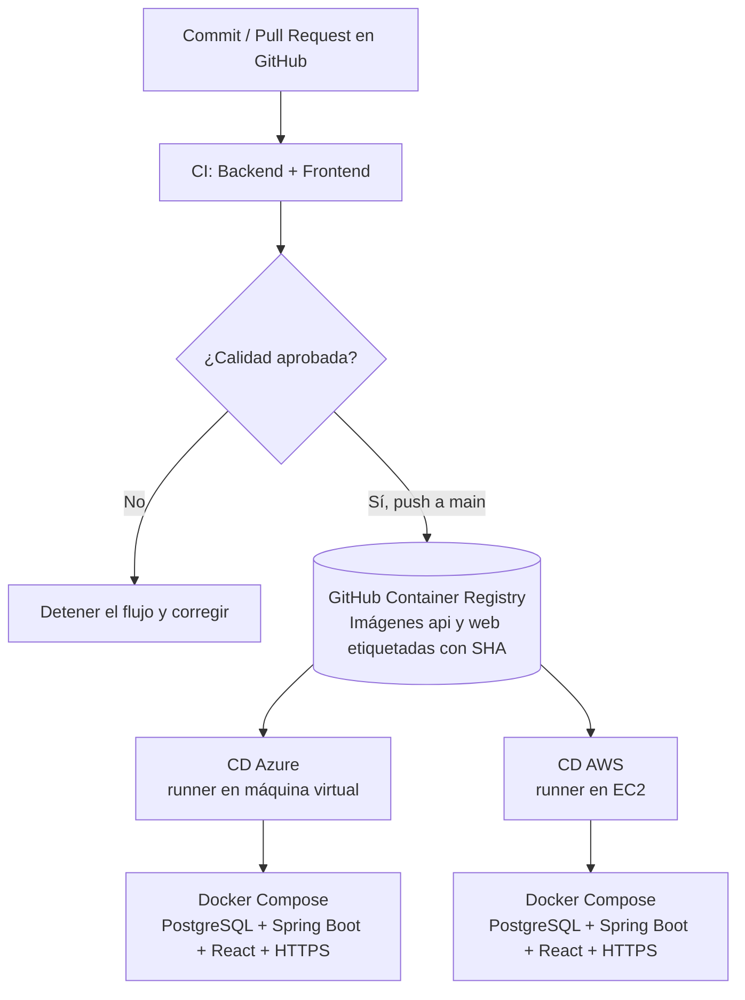

# LABORATORIO · CI/CD MULTINUBE PARA APP ToDo

> **Curso:** Desarrollo y Operaciones de Software (DOSW)  
> **Institución:** Escuela Colombiana de Ingeniería Julio Garavito  
> **Docente:** Rodrigo Gualtero  
> **Proyecto base:** App ToDo (Spring Boot + Maven + JPA + PostgreSQL + React)  
> **Modalidad:** Práctico, por equipos, sobre el repositorio de la aplicación desarrollada en laboratorios anteriores.

## 1. Contexto y reto

Ya cuentan con una aplicación Full Stack que permite gestionar tareas. En el laboratorio anterior se incorporó autenticación/autorización con Spring Security y JWT. Ahora deben **automatizar la validación y el despliegue de la MISMA aplicación en dos proveedores de nube**.

Se implementarán **tres pipelines independientes de GitHub Actions**:

| Pipeline | Archivo | Disparador | Resultado |
|---|---|---|---|
| CI: integración, pruebas, calidad e imágenes | `.github/workflows/ci-quality.yml` | Push y Pull Request | Build, tests, SpotBugs/ESLint, JaCoCo/Vitest y publicación de imágenes por commit cuando se integra a `main` |
| CD: despliegue en Azure | `.github/workflows/deploy-azure.yml` | Manual (`workflow_dispatch`) desde `main` | Compose ejecutado en VM Azure con la imagen ya publicada |
| CD: despliegue en AWS Academy | `.github/workflows/deploy-aws.yml` | Manual (`workflow_dispatch`) desde `main` | Compose ejecutado en EC2 con la misma imagen |

**Importante:** Los archivos de ejemplo de este documento deben **adaptarse al proyecto real**: nombres de paquetes, rutas, dependencias y propiedades de seguridad pueden ser distintos. No modifiquen el contrato REST existente solo para facilitar el despliegue.

### Resultado esperado



En ambas nubes el backend, el frontend y la base de datos estarán **contenerizados**. Un contenedor Caddy servirá de entrada HTTPS y el frontend Nginx reenviará las rutas `/api/` al backend, evitando exponer PostgreSQL o el puerto interno de Spring Boot a Internet.

---

## 2. Requerimientos funcionales y técnicos

- **RF-CI-01:** ejecutar automáticamente build y pruebas del backend Maven ante cambios en ramas de trabajo/integración.
- **RF-CI-02:** ejecutar ESLint, pruebas, cobertura y build del frontend React.
- **RF-CI-03:** analizar defectos potenciales de Java mediante SpotBugs; la etapa debe fallar si existen errores configurados como bloqueantes.
- **RF-CI-04:** generar reportes descargables de cobertura de backend (JaCoCo) y frontend (Vitest).
- **RF-CI-05:** establecer umbral de cobertura mínimo **80 %** en lógica relevante de backend/frontend, justificando exclusiones.
- **RF-CI-06:** publicar **dos imágenes Docker** solo después de superar las verificaciones de calidad en `main`: `api` y `web`, ambas con la misma etiqueta basada en commit SHA.
- **RF-CD-01:** poder desplegar esas imágenes en **Azure** ejecutando el pipeline correspondiente.
- **RF-CD-02:** poder desplegar esas mismas imágenes en **AWS Academy**, sin reconstruirlas de forma distinta.
- **RF-CD-03:** usar PostgreSQL en contenedor con volumen persistente; **no** publicar el puerto 5432.
- **RF-CD-04:** mantener secretos fuera del repositorio y gestionar variables de GitHub Actions por ambiente.
- **RF-CD-05:** validar, después de cada despliegue, que el sitio responde por HTTPS y que la API protegida rechaza una consulta sin JWT.
- **RF-CD-06:** documentar cómo consultar logs, reiniciar, revertir una versión y liberar recursos para reducir costos.

### Historias de usuario

**HU-CI-01.** Como desarrollador, quiero que cada Pull Request ejecute automáticamente compilación, análisis estático y pruebas para detectar defectos antes de integrar cambios.

**HU-CI-02.** Como equipo, quiero consultar reportes y umbrales de cobertura para mejorar la calidad del código y evitar integraciones sin pruebas.

**HU-CI-03.** Como responsable de una entrega, quiero imágenes versionadas e identificables por commit para desplegar la misma versión en distintos ambientes.

**HU-CD-01.** Como responsable de operación, quiero ejecutar un despliegue manual en Azure solo si la calidad es satisfactoria, y verificar el funcionamiento de App ToDo por HTTPS.

**HU-CD-02.** Como responsable de operación, quiero repetir el despliegue en AWS Academy usando los mismos contenedores, para comparar ambos proveedores.

**HU-CD-03.** Como responsable de operación, quiero conservar los datos aunque se recreen los contenedores y poder volver a una versión anterior de la aplicación.

> **Criterios verificables:** los workflows deben producir evidencias reales (ejecuciones, reportes, paquetes, capturas y URL de cada nube). No es suficiente incluir archivos YAML que nunca se ejecutaron.

---

## 3. Prerrequisitos y decisiones de arquitectura

### 3.1. Herramientas

- Repositorio GitHub **privado**, GitHub Actions habilitado y permisos para configurar *Actions / Runners / Environments / Packages*.
- Java 17, Maven 3.9+, Node.js 22, npm y Docker Engine con plugin Docker Compose.
- Aplicación ToDo ya funcionando localmente: Spring Boot, React, API REST, PostgreSQL y pruebas.
- Acceso a la suscripción **Azure for Students** (o suscripción educativa institucional habilitada).
- Acceso al entorno **AWS Academy Learner Lab** y permisos efectivos para iniciar instancias EC2.
- Dos VMs Linux Ubuntu de laboratorio: una en Azure y otra en AWS. Se recomienda una máquina con aproximadamente **2 vCPU y 4 GiB RAM** si la cuota y el presupuesto lo permiten; confirme disponibilidad y costos antes de crearla.
- Una forma de resolver **un dominio DNS por cada IP pública**. Pueden usar un subdominio propio o un dominio temporal como `IP_PUBLICA.sslip.io` para demostración **si resuelve correctamente**. La expedición de certificados en dominios compartidos puede fallar por límites del proveedor: si ocurre, usar un dominio administrado por ustedes.

### 3.2. ¿Por qué máquinas virtuales con Docker Compose?

- El mismo paquete OCI se ejecuta en Azure y AWS, sin acoplar la aplicación a una API específica del proveedor.
- No se requiere desplegar Azure Container Registry, Azure Container Apps, ECS o ECR, servicios que podrían añadir permisos o costos en cuentas educativas.
- Se utilizará un **self-hosted runner de GitHub Actions en cada VM**, que recibe trabajos por conexiones HTTPS salientes. Así no necesitamos guardar llaves SSH de las VMs en GitHub ni abrir el puerto SSH para todas las IPs de los runners hospedados de GitHub.
- Los despliegues se lanzarán **manualmente**; la integración y publicación en `main` sí será automática. De este modo, cada equipo controla cuándo consume sus créditos cloud.

**Requisito operativo:** La VM de cada nube debe estar encendida y su runner conectado cuando se dispare el pipeline correspondiente. AWS Academy puede detener entornos fuera de la sesión autorizada.

**Limitaciones:** Esta solución es adecuada para un laboratorio académico. No equivale a una arquitectura productiva escalable (no contiene alta disponibilidad, múltiples réplicas, backups automatizados ni orquestación avanzada). **No usen contraseñas reales ni datos personales reales** para la demostración.

### 3.3. ¿Qué deben comprobar del proyecto anterior?

1. La aplicación debe construir el backend con `mvn clean verify` y el frontend con `npm ci && npm run build`.
2. Las solicitudes del React deben utilizar **rutas relativas** como `/api/v1/tasks`, `/api/v1/auth/login` en lugar de `http://localhost:8080/...` incrustado en el código de producción.
3. En desarrollo pueden configurar un proxy de Vite `/api -> http://localhost:8080`; en la imagen final, **Nginx** hará ese proxy internamente.
4. La configuración de PostgreSQL y la clave de firma JWT deben leerse desde **variables de entorno** (`SPRING_DATASOURCE_*`, `JWT_SECRET` o los nombres que use su aplicación).
5. Los endpoints `/api/v1/tasks` deben exigir JWT. El ejemplo de validación de este laboratorio espera **HTTP 401 sin token**; si su contrato usa otra ruta, actualicen el smoke test y documenten la equivalencia.
6. El esquema SQL que el equipo desarrolló, incluyendo usuarios/roles/tareas si ya implementó JWT, debe poder inicializarse en una BD vacía mediante scripts o migraciones.

---

## 4. Estructura esperada del repositorio

Mantengan el código previo y agreguen los archivos del laboratorio:

```text
app-todo/
├── .github/
│   └── workflows/
│       ├── ci-quality.yml
│       ├── deploy-azure.yml
│       └── deploy-aws.yml
├── backend/
│   ├── Dockerfile
│   ├── .dockerignore
│   ├── pom.xml
│   └── src/
├── frontend/
│   ├── Dockerfile
│   ├── .dockerignore
│   ├── nginx.conf
│   ├── package.json
│   └── src/
├── infra/
│   ├── docker-compose.prod.yml
│   ├── Caddyfile
│   ├── .env.example
│   └── db/
│       └── [scripts SQL / migraciones del equipo]
├── docs/
│   ├── ci-cd-evidencias/
│   ├── arquitectura/
│   └── informe-cicd.md
├── .gitignore
└── README.md
```

Cada ruta es orientativa: si el laboratorio anterior utiliza otra estructura, documenten los ajustes para que cada `working-directory`, `Dockerfile` y ruta relativa sea correcta.

---

# PARTE A · PRIMER PIPELINE: INTEGRACIÓN, ANÁLISIS Y COBERTURA

## 5. Etapa A1. Preparar calidad del backend Java

### 5.1. Pruebas y cobertura con JaCoCo

Modificar `backend/pom.xml`, dentro de `<build><plugins>` (integrar con lo que ya exista, **sin duplicar** plugins):

```xml
<plugin>
  <groupId>org.jacoco</groupId>
  <artifactId>jacoco-maven-plugin</artifactId>
  <version>0.8.15</version>
  <executions>
    <execution>
      <goals><goal>prepare-agent</goal></goals>
    </execution>
    <execution>
      <id>jacoco-report</id>
      <phase>verify</phase>
      <goals><goal>report</goal></goals>
    </execution>
    <execution>
      <id>jacoco-check</id>
      <phase>verify</phase>
      <goals><goal>check</goal></goals>
      <configuration>
        <rules>
          <rule>
            <element>BUNDLE</element>
            <limits>
              <limit>
                <counter>LINE</counter>
                <value>COVEREDRATIO</value>
                <minimum>0.80</minimum>
              </limit>
            </limits>
          </rule>
        </rules>
      </configuration>
    </execution>
  </executions>
</plugin>
```

El `verify` genera un reporte y **falla el pipeline** cuando el umbral definido no se cumple. Excluir únicamente código justificado (por ejemplo, clases generadas por herramientas), no toda la lógica de negocio.

### 5.2. Análisis estático con SpotBugs

Añadir al mismo bloque `<plugins>`:

```xml
<plugin>
  <groupId>com.github.spotbugs</groupId>
  <artifactId>spotbugs-maven-plugin</artifactId>
  <version>4.10.5.0</version>
  <configuration>
    <effort>Max</effort>
    <threshold>Medium</threshold>
  </configuration>
  <executions>
    <execution>
      <id>spotbugs-verify</id>
      <phase>verify</phase>
      <goals>
        <goal>spotbugs</goal>
        <goal>check</goal>
      </goals>
    </execution>
  </executions>
</plugin>
```

Antes de crear GitHub Actions, ejecutar desde `backend/`:

```bash
mvn -B -ntp clean verify
```

Comprobar:

- `target/surefire-reports/` registra el resultado de los tests.
- `target/site/jacoco/index.html` abre el reporte HTML.
- SpotBugs identifica advertencias para corregir y la etapa `check` impide aprobar defectos bloqueantes.
- No se permite resolver fallos de calidad eliminando pruebas, deshabilitando el plugin o bajando arbitrariamente la cobertura.

**Prueba deliberada:** introduzcan temporalmente un error pequeño que cause una prueba fallida. Registren en evidencia la ejecución fallida, corríjanlo y guarden luego el pipeline exitoso.

## 6. Etapa A2. Preparar calidad del frontend React

En `frontend/` instalen o verifiquen las dependencias:

```bash
npm install --save-dev vitest @vitest/coverage-v8 @testing-library/react @testing-library/jest-dom jsdom
```

En el `package.json`, integren los scripts existentes con estos nombres:

```json
{
  "scripts": {
    "lint": "eslint .",
    "test:coverage": "vitest run --coverage",
    "build": "vite build"
  }
}
```

> Conserven los demás scripts y dependencias actuales del `package.json`. No reemplacen el archivo completo por este fragmento. Si sus tests requieren DOM, configuren Vitest con `environment: 'jsdom'`.

Ejemplo de configuración para `frontend/vite.config.js` (integrar con el plugin React si ya está configurado):

```javascript
import { defineConfig } from 'vitest/config';
import react from '@vitejs/plugin-react';

export default defineConfig({
  plugins: [react()],
  server: {
    proxy: {
      '/api': 'http://localhost:8080'
    }
  },
  test: {
    environment: 'jsdom',
    coverage: {
      provider: 'v8',
      reporter: ['text', 'html', 'lcov'],
      include: ['src/**/*.{js,jsx,ts,tsx}'],
      exclude: ['src/main.jsx', 'src/**/*.test.*'],
      thresholds: {
        lines: 80,
        functions: 80,
        branches: 80,
        statements: 80
      }
    }
  }
});
```

Ejecutar:

```bash
npm ci
npm run lint
npm run test:coverage
npm run build
```

**Preguntas de análisis:** ¿qué diferencia existe entre test que pasa y cobertura alta? ¿Por qué un error estático no es necesariamente un fallo de ejecución? ¿Cómo se asegura que el código probado sea el que se incorpora a `main`?

## 7. Etapa A3. Preparar imágenes de Docker (build multietapa)

Se crearán **dos imágenes propias**, una para el backend y otra para el frontend. PostgreSQL y Caddy usan imágenes oficiales y NO se reconstruyen.

### 7.1. Dockerfile del backend

**Archivo:** `backend/Dockerfile`

```dockerfile
# Etapa 1: compilación reproducible con Maven
FROM maven:3.9-eclipse-temurin-17 AS build
WORKDIR /workspace
COPY pom.xml ./
RUN mvn -B -ntp dependency:go-offline
COPY src ./src
# Las pruebas ya se ejecutan en CI; no se saltan las validaciones del pipeline.
RUN mvn -B -ntp -DskipTests package

# Etapa 2: runtime compacto (sin Maven ni fuentes)
FROM eclipse-temurin:17-jre
WORKDIR /app
COPY --from=build /workspace/target/*.jar app.jar
EXPOSE 8080
ENTRYPOINT ["java", "-jar", "/app/app.jar"]
```

**Qué ocurre:** Maven compila el `.jar` en una etapa y una imagen JRE ejecuta el resultado en otra. Esto evita incluir el código fuente y Maven dentro de la imagen final. El `-DskipTests` se utiliza **solo en la construcción de la imagen**, porque el pipeline CI ya habrá ejecutado los tests previamente y bloqueará su publicación si fallan.

**Archivo:** `backend/.dockerignore`

```text
target
.git
.idea
.vscode
*.iml
.env
```

### 7.2. Dockerfile del frontend

**Archivo:** `frontend/Dockerfile`

```dockerfile
# Etapa 1: construir React / Vite
FROM node:22-alpine AS build
WORKDIR /app
COPY package.json package-lock.json ./
RUN npm ci
COPY . .
RUN npm run build

# Etapa 2: entregar recursos estáticos por Nginx
FROM nginx:alpine
COPY nginx.conf /etc/nginx/conf.d/default.conf
COPY --from=build /app/dist /usr/share/nginx/html
EXPOSE 80
```

**Archivo:** `frontend/nginx.conf`

```nginx
server {
    listen 80;
    server_name _;
    root /usr/share/nginx/html;
    index index.html;

    location = /health {
        default_type text/plain;
        return 200 'ok';
    }

    # Mismo origen: React consume /api/... sin configurar CORS entre dominios.
    location /api/ {
        proxy_pass http://backend:8080;
        proxy_http_version 1.1;
        proxy_set_header Host $host;
        proxy_set_header X-Real-IP $remote_addr;
        proxy_set_header X-Forwarded-For $proxy_add_x_forwarded_for;
        proxy_set_header X-Forwarded-Proto $http_x_forwarded_proto;
    }

    # Soporte para React Router (Single Page Application).
    location / {
        try_files $uri $uri/ /index.html;
    }
}
```

Este archivo sirve React como una SPA y actúa como proxy de `/api/` hacia `backend:8080`. Debe verificarse que en `taskApi.js` y en el módulo de autenticación las URLs apunten a rutas relativas como `'/api/v1/tasks'`.

**Archivo:** `frontend/.dockerignore`

```text
node_modules
dist
coverage
.git
.env*
```

### 7.3. Construcción y prueba local

En la raíz del repositorio:

```bash
docker build -t todo-api:local ./backend
docker build -t todo-web:local ./frontend
docker images | grep todo
```

Para el runtime completo, usaremos más adelante Docker Compose. Si el Dockerfile falla por nombres de artefactos, versionado Java o dependencias, ajusten las rutas **en lugar de omitir controles de calidad**.

## 8. Etapa A4. Crear el workflow de integración

Crear `.github/workflows/ci-quality.yml`:

**Archivo:** `.github/workflows/ci-quality.yml`

```yaml
name: CI - calidad y contenedores

on:
  push:
    branches: [main, develop]
  pull_request:
    branches: [main, develop]
  workflow_call:

permissions:
  contents: read

jobs:
  backend-quality:
    name: Java - pruebas, cobertura y SpotBugs
    runs-on: ubuntu-latest
    services:
      postgres:
        image: postgres:17-alpine
        env:
          POSTGRES_DB: todo_db
          POSTGRES_USER: todo_user
          POSTGRES_PASSWORD: todo_ci_only
        ports: ['5432:5432']
        options: >-
          --health-cmd "pg_isready -U todo_user -d todo_db"
          --health-interval 5s --health-timeout 5s --health-retries 10
    defaults:
      run:
        working-directory: backend
    env:
      SPRING_DATASOURCE_URL: jdbc:postgresql://localhost:5432/todo_db
      SPRING_DATASOURCE_USERNAME: todo_user
      SPRING_DATASOURCE_PASSWORD: todo_ci_only
      SPRING_JPA_HIBERNATE_DDL_AUTO: create-drop
      JWT_SECRET: test-only-long-nonproduction-secret-please-do-not-use
    steps:
      - uses: actions/checkout@v4
      - uses: actions/setup-java@v4
        with:
          distribution: temurin
          java-version: '17'
          cache: maven
          cache-dependency-path: backend/pom.xml
      - name: Compilar + pruebas + verificaciones Maven
        run: mvn -B -ntp clean verify
      - name: Guardar reporte de cobertura
        if: always()
        uses: actions/upload-artifact@v4
        with:
          name: backend-jacoco
          path: backend/target/site/jacoco/
          if-no-files-found: warn

  frontend-quality:
    name: React - lint, pruebas, cobertura y build
    runs-on: ubuntu-latest
    defaults:
      run:
        working-directory: frontend
    steps:
      - uses: actions/checkout@v4
      - uses: actions/setup-node@v4
        with:
          node-version: '22'
          cache: npm
          cache-dependency-path: frontend/package-lock.json
      - name: Instalar dependencias fijadas en lockfile
        run: npm ci
      - name: Análisis estático ESLint
        run: npm run lint
      - name: Pruebas y cobertura
        run: npm run test:coverage
      - name: Build de React
        run: npm run build
      - name: Guardar reporte de cobertura
        if: always()
        uses: actions/upload-artifact@v4
        with:
          name: frontend-coverage
          path: frontend/coverage/
          if-no-files-found: warn

  publish-images:
    name: Publicar imágenes GHCR (solo main)
    if: github.event_name == 'push' && github.ref == 'refs/heads/main'
    needs: [backend-quality, frontend-quality]
    runs-on: ubuntu-latest
    permissions:
      contents: read
      packages: write
    steps:
      - uses: actions/checkout@v4
      - uses: docker/setup-buildx-action@v3
      - name: Autenticarse en GHCR
        uses: docker/login-action@v3
        with:
          registry: ghcr.io
          username: ${{ github.actor }}
          password: ${{ secrets.GITHUB_TOKEN }}
      - name: Identificadores de imagen (únicos por repositorio)
        id: meta
        shell: bash
        run: |
          echo "base=ghcr.io/${GITHUB_REPOSITORY,,}" >> "$GITHUB_OUTPUT"
          echo "tag=sha-${GITHUB_SHA}" >> "$GITHUB_OUTPUT"
      - name: Publicar imagen Spring Boot
        uses: docker/build-push-action@v6
        with:
          context: ./backend
          file: ./backend/Dockerfile
          push: true
          tags: ${{ steps.meta.outputs.base }}-api:${{ steps.meta.outputs.tag }}
      - name: Publicar imagen React / Nginx
        uses: docker/build-push-action@v6
        with:
          context: ./frontend
          file: ./frontend/Dockerfile
          push: true
          tags: ${{ steps.meta.outputs.base }}-web:${{ steps.meta.outputs.tag }}
```

### 8.1. Interpretación del pipeline

1. `push` y `pull_request` disparan verificaciones de backend y frontend en **runners hospedados por GitHub** (`ubuntu-latest`).
2. El trabajo Java levanta un PostgreSQL temporal como servicio de prueba. Sus credenciales son **solo de CI**, no corresponden a las instancias desplegadas.
3. `mvn clean verify` compila, corre tests, produce reportes y ejecuta JaCoCo/SpotBugs configurados en el `pom.xml`.
4. `npm ci` usa el `package-lock.json`, ESLint realiza análisis estático y Vitest ejecuta pruebas y cobertura; Vite produce `dist/`.
5. `upload-artifact` adjunta los reportes a la ejecución de Actions para revisarlos desde la interfaz de GitHub.
6. `publish-images` depende de ambos trabajos. **Solo en un push exitoso a `main`** publica las imágenes `ghcr.io/OWNER/REPO-api:sha-COMMIT` y `ghcr.io/OWNER/REPO-web:sha-COMMIT`.
7. La etiqueta SHA evita confundir versiones; el uso de nombres `OWNER/REPO` evita colisiones entre equipos que compartan una organización de GitHub.

### 8.2. Permisos en GitHub Container Registry (GHCR)

1. En el repositorio, verifiquen que `Settings > Actions > General` permita ejecutar workflows (de acuerdo con las políticas de la organización).
2. El trabajo de publicación requiere permiso `packages: write`; los trabajos de despliegue requieren `packages: read`.
3. Cuando GHCR publica imágenes por primera vez, normalmente quedan **privadas**. Los archivos de los pipelines ya usan el `GITHUB_TOKEN` para publicar y descargar imágenes conectadas al mismo repositorio; no deben crear un Personal Access Token para esta ruta.
4. Si el package ya existe y no está asociado al repositorio, un administrador deberá conceder explícitamente acceso en los ajustes del paquete.
5. No publiquen una imagen con secretos, ni incluyan `.env`, claves JWT o contraseñas en el build context.

### 8.3. Validación en GitHub

- Abran una rama `feature/cicd-quality`, incorporen los cambios y creen un Pull Request a `develop`.
- Comprueben que **ambos jobs de calidad** aparecen, ejecutan pruebas y adjuntan artifacts.
- Introduzcan una falla controlada en una prueba y verifiquen que el PR queda en rojo. Corrijan la prueba y documenten el resultado.
- Después de integrar una versión que pase a `main`, comprueben que el tercer job **Publicar imágenes GHCR** se ejecuta.
- Desde **GitHub > Packages**, verifiquen la existencia de las dos imágenes y su etiqueta asociada al SHA de `main`.

> **Advertencia:** si hay ramas protegidas, es necesario configurar revisiones y *required status checks* conforme a las reglas del repositorio. El bloqueo por calidad debe ocurrir antes de permitir el merge.

---

# PARTE B · INFRAESTRUCTURA CONTENERIZADA REUTILIZABLE

## 9. Etapa B1. Definir el stack productivo del laboratorio

Crear el archivo `infra/docker-compose.prod.yml`:

**Archivo:** `infra/docker-compose.prod.yml`

```yaml
name: todo-lab
services:
  db:
    image: postgres:17-alpine
    restart: unless-stopped
    environment:
      POSTGRES_DB: todo_db
      POSTGRES_USER: todo_user
      POSTGRES_PASSWORD: ${DB_PASSWORD:?Falta DB_PASSWORD}
    volumes:
      - todo_pgdata:/var/lib/postgresql/data
      - ./db:/docker-entrypoint-initdb.d:ro
    healthcheck:
      test: ["CMD-SHELL", "pg_isready -U todo_user -d todo_db"]
      interval: 10s
      timeout: 5s
      retries: 8
    networks: [internal]

  backend:
    image: ${IMAGE_NAMESPACE:?Falta IMAGE_NAMESPACE}-api:${IMAGE_TAG:?Falta IMAGE_TAG}
    restart: unless-stopped
    environment:
      SPRING_DATASOURCE_URL: jdbc:postgresql://db:5432/todo_db
      SPRING_DATASOURCE_USERNAME: todo_user
      SPRING_DATASOURCE_PASSWORD: ${DB_PASSWORD:?Falta DB_PASSWORD}
      JWT_SECRET: ${JWT_SECRET:?Falta JWT_SECRET}
      SPRING_JPA_HIBERNATE_DDL_AUTO: validate
    depends_on:
      db:
        condition: service_healthy
    networks: [internal]

  frontend:
    image: ${IMAGE_NAMESPACE:?Falta IMAGE_NAMESPACE}-web:${IMAGE_TAG:?Falta IMAGE_TAG}
    restart: unless-stopped
    depends_on: [backend]
    networks: [internal]

  proxy:
    image: caddy:2-alpine
    restart: unless-stopped
    ports:
      - "80:80"
      - "443:443"
    environment:
      TODO_DOMAIN: ${TODO_DOMAIN:?Falta TODO_DOMAIN}
    volumes:
      - ./Caddyfile:/etc/caddy/Caddyfile:ro
      - caddy_data:/data
      - caddy_config:/config
    depends_on: [frontend]
    networks: [internal]

volumes:
  todo_pgdata:
  caddy_data:
  caddy_config:

networks:
  internal:
    driver: bridge
```

### ¿Qué hace cada servicio?

| Servicio | Rol | Exposición pública |
|---|---|---|
| `db` | PostgreSQL 17, volumen persistente `todo_pgdata` | No publica 5432 |
| `backend` | API REST Spring Boot + JWT, acceso JDBC interno | No publica 8080 |
| `frontend` | Nginx y recursos estáticos React, proxy `/api/` | Solo red interna |
| `proxy` | Caddy, redirección y terminación HTTPS | Puertos 80/443 |

El nombre de la red y de los servicios es usado por Compose para resolver `db:5432`, `backend:8080` y `frontend:80`. En Docker **no se debe utilizar `localhost` para comunicar contenedores distintos**.

**Persistencia:** El volumen de PostgreSQL no debe borrarse durante un despliegue. Nunca ejecutar `docker compose down -v` como parte del CD.

**Esquema:** La carpeta `infra/db/` debe contener los scripts SQL propios del equipo (esquema de usuarios, roles y tareas). La imagen PostgreSQL ejecuta scripts de inicialización **solo cuando el volumen está vacío**. Para cambios posteriores deben utilizar migraciones versionadas; el modo del backend es `ddl-auto=validate`.

Si el equipo no tiene inicialización reproducible, **esta parte del laboratorio está incompleta**: deben recuperarla del laboratorio de persistencia o crear migraciones antes del despliegue.

### 9.1. HTTPS con Caddy

Crear `infra/Caddyfile`:

**Archivo:** `infra/Caddyfile`

```caddyfile
{$TODO_DOMAIN} {
    encode zstd gzip
    reverse_proxy frontend:80
}
```

Configurar `TODO_DOMAIN` con un dominio cuyo registro DNS apunte a la IP pública de la VM. Caddy puede obtener certificados automáticamente **si el dominio resuelve bien y los puertos públicos 80 y 443 están disponibles**. No se permite desactivar la verificación TLS para pasar el smoke test.

**Para una demo sin dominio propio:** pueden intentar `DIRECCION_IP_PUBLICA.sslip.io` o `IP-EN-GUIONES.sslip.io`, siempre verificando DNS. Las autoridades certificadoras pueden imponer límites de emisión en dominios compartidos; si el certificado no se emite, deberán utilizar otro nombre de dominio bajo su control o consultar al docente.

### 9.2. Variables y secretos

Crear `infra/.env.example` como guía pública. **No incluir credenciales reales.**

**Archivo:** `infra/.env.example`

```dotenv
# NO usar estos valores en producción. Copiar a .env y generar secretos.
IMAGE_NAMESPACE=ghcr.io/organizacion/repositorio
IMAGE_TAG=sha-REEMPLAZAR_CON_SHA_COMPLETO
TODO_DOMAIN=todo.tu-dominio.edu.co
DB_PASSWORD=REEMPLAZAR_CON_PASSWORD_ALEATORIO
JWT_SECRET=REEMPLAZAR_CON_SECRETO_ALEATORIO_LARGO
```

Añadan a `.gitignore`:

```gitignore
.env
.env.*
!.env.example
**/.env
**/.env.*
!**/.env.example
**/node_modules/
**/target/
**/dist/
**/coverage/
```

Para generar claves de prueba en una máquina local (no subirlas al repositorio):

```bash
openssl rand -hex 24    # contraseña de PostgreSQL (ejemplo)
openssl rand -hex 48    # secreto HMAC largo para JWT (ejemplo)
```

Si el módulo JWT emplea RSA u otro mecanismo de firma asimétrica, debe adaptarse la configuración y gestionar el par de claves como secretos: **no forzar HMAC sobre una implementación RSA existente**.

### 9.3. Prueba local de la infraestructura

1. Verifiquen que el código backend acepta las variables de conexión y JWT.
2. Verifiquen que `infra/db` contiene SQL compatible con sus entidades JPA o las migraciones necesarias.
3. Tras publicar imágenes por primera vez, creen un `.env` local en `infra/` con credenciales ficticias y las dos imágenes correctas.
4. Para una prueba local inicial se puede usar `TODO_DOMAIN=localhost` (Caddy entregará HTTPS local con certificado no confiable en el navegador). Para despliegues cloud usar DNS público y TLS verificable.
5. Desde `infra/`:

```bash
docker compose --env-file .env -f docker-compose.prod.yml config --quiet
docker compose --env-file .env -f docker-compose.prod.yml pull
docker compose --env-file .env -f docker-compose.prod.yml up -d
docker compose --env-file .env -f docker-compose.prod.yml ps
```

Comprobación de base de datos:

```bash
docker compose --env-file .env -f docker-compose.prod.yml \
  exec db psql -U todo_user -d todo_db -c '\dt'
```

Para detener sin borrar los datos:

```bash
docker compose --env-file .env -f docker-compose.prod.yml down
```

---

# PARTE C · SEGUNDO PIPELINE: DESPLIEGUE EN MICROSOFT AZURE

## 10. Etapa C1. Preparar Azure for Students

1. Inicien sesión en el **Azure Portal** con su cuenta académica y seleccionen la suscripción con créditos habilitados.
2. Revisen el presupuesto/consumo disponible. El hecho de contar con créditos académicos **no garantiza que todas las familias de VM estén permitidas**.
3. Abran **Virtual machines > Create > Azure virtual machine**.
4. Grupo de recursos sugerido: `rg-dosw-todo-lab`. Nombre: `vm-dosw-todo-azure`.
5. Imagen: **Ubuntu Server LTS**, arquitectura x64. Seleccionar tamaño dentro del presupuesto, idealmente **2 vCPU / 4 GiB**.
6. Autenticación: **llave SSH**. Guarden la llave privada localmente con permisos seguros; no suban la llave a GitHub.
7. Red: IP pública. Permitir **80/TCP y 443/TCP** desde Internet para el sitio; restringir **22/TCP solamente a la IP pública del estudiante**. No permitir 5432 ni 8080 desde Internet.
8. Confirmar el costo estimado antes de crear la VM. Guardar identificador, región, IP y evidencia del grupo de recursos.
9. Entrar por SSH desde su computador, usando usuario y llave asociados a la VM.

Ejemplo (reemplazar datos propios):

```bash
chmod 600 ~/Downloads/azure-todo.pem
ssh -i ~/Downloads/azure-todo.pem azureuser@IP_PUBLICA_AZURE
```

**Comprobación:** la VM responde a SSH, tiene acceso saliente a Internet y cuenta con espacio libre razonable para imágenes y volumen de base de datos.

## 11. Etapa C2. Instalar Docker y Docker Compose

Ejecutar **dentro de la VM** (Ubuntu LTS):

```bash
sudo apt-get update
sudo apt-get install -y ca-certificates curl gnupg
sudo install -m 0755 -d /etc/apt/keyrings
sudo curl -fsSL https://download.docker.com/linux/ubuntu/gpg \
  -o /etc/apt/keyrings/docker.asc
sudo chmod a+r /etc/apt/keyrings/docker.asc

. /etc/os-release
printf 'deb [arch=%s signed-by=/etc/apt/keyrings/docker.asc] %s %s stable\n' \
  "$(dpkg --print-architecture)" \
  "https://download.docker.com/linux/ubuntu" \
  "$VERSION_CODENAME" | sudo tee /etc/apt/sources.list.d/docker.list >/dev/null

sudo apt-get update
sudo apt-get install -y docker-ce docker-ce-cli containerd.io \
  docker-buildx-plugin docker-compose-plugin
sudo systemctl enable --now docker
sudo usermod -aG docker "$USER"
```

**Cerrar la sesión SSH y volver a entrar** para activar el grupo `docker`. Luego:

```bash
docker version
docker compose version
docker run --rm hello-world
```

> **Seguridad:** pertenecer al grupo `docker` concede permisos equivalentes a administrador sobre la máquina. No instalen el runner de acciones en un servidor compartido con aplicaciones o datos reales. Si la instalación de Docker falla por arquitectura/versión de Ubuntu, sigan la documentación oficial para la distribución efectivamente creada.

## 12. Etapa C3. Instalar un self-hosted runner en la VM Azure

En el repositorio GitHub:

1. Vayan a **Settings > Actions > Runners > New self-hosted runner**.
2. Seleccionen **Linux / x64**.
3. En la VM Azure, creen `~/actions-runner` y sigan **exactamente** los comandos que GitHub muestra para descargar y configurar el runner. El instalador y su token cambian; **no se comparten ni se incluyen en el README**.
4. Al ejecutar el comando sugerido `./config.sh --url ... --token ...`, agreguen un identificador único para la nube:

```bash
# Ejemplo de la parte final de la configuración, no un token real:
./config.sh --url https://github.com/OWNER/REPO \
  --token TOKEN_TEMPORAL_DEL_PORTAL \
  --labels azure-todo
```

5. Instalen el runner como servicio desde `~/actions-runner`:

```bash
sudo ./svc.sh install
sudo ./svc.sh start
sudo ./svc.sh status
```

6. Vuelvan a GitHub y comprueben que aparece **Online**, con etiquetas: `self-hosted`, `linux`, `x64`, `azure-todo`.
7. Este runner debe pertenecer **únicamente al repositorio privado del laboratorio** y usar código confiable de `main`. No lo utilicen para ejecutar PRs sin revisar, especialmente de autores externos.

**¿Por qué funciona sin credenciales permanentes de Azure?** La máquina se crea por el portal, y el runner ejecuta Docker Compose **localmente** cuando GitHub le asigna el trabajo. Los servicios de GitHub usados por el runner requieren conectividad HTTPS saliente, no acceso SSH abierto desde Internet.

## 13. Etapa C4. Crear secretos y variable de entorno Azure

En GitHub, crear **Settings > Environments > New environment** con nombre `azure-lab`. Crear allí:

| Tipo | Nombre | Valor |
|---|---|---|
| Secret | `AZURE_DB_PASSWORD` | Contraseña segura generada con `openssl rand -hex 24` |
| Secret | `AZURE_JWT_SECRET` | Secreto JWT largo compatible con el algoritmo de la app |
| Variable | `AZURE_DOMAIN` | Dominio público de Azure, **sin** `https://`, por ejemplo `todo-azure.ejemplo.edu.co` |

El `.env` de ejecución se generará automáticamente en la VM por el workflow y tendrá permisos restringidos. **No copiar secretos en capturas ni en logs**.

## 14. Etapa C5. Crear el pipeline CD de Azure

Crear `.github/workflows/deploy-azure.yml`:

**Archivo:** `.github/workflows/deploy-azure.yml`

```yaml
name: CD - Azure VM

on:
  workflow_dispatch:

permissions:
  contents: read
  packages: read

concurrency:
  group: deploy-azure-todo
  cancel-in-progress: false

jobs:
  quality-gate:
    name: Revalidar calidad antes del despliegue
    uses: ./.github/workflows/ci-quality.yml

  deploy-azure:
    name: Desplegar contenedores en Azure
    if: github.ref == 'refs/heads/main'
    needs: quality-gate
    runs-on: [self-hosted, linux, x64, azure-todo]
    environment: azure-lab
    timeout-minutes: 20
    steps:
      - uses: actions/checkout@v4
      - name: Preparar configuración y desplegar
        shell: bash
        env:
          GHCR_TOKEN: ${{ secrets.GITHUB_TOKEN }}
          DB_PASSWORD: ${{ secrets.AZURE_DB_PASSWORD }}
          JWT_SECRET: ${{ secrets.AZURE_JWT_SECRET }}
          TODO_DOMAIN: ${{ vars.AZURE_DOMAIN }}
        run: |
          set -euo pipefail
          : "${DB_PASSWORD:?Configurar AZURE_DB_PASSWORD}"
          : "${JWT_SECRET:?Configurar AZURE_JWT_SECRET}"
          : "${TODO_DOMAIN:?Configurar variable AZURE_DOMAIN}"
          export IMAGE_NAMESPACE="ghcr.io/${GITHUB_REPOSITORY,,}"
          export IMAGE_TAG="sha-${GITHUB_SHA}"

          DEPLOY_DIR="$HOME/todo-azure"
          mkdir -p "$DEPLOY_DIR/db"
          cp infra/docker-compose.prod.yml "$DEPLOY_DIR/docker-compose.prod.yml"
          cp infra/Caddyfile "$DEPLOY_DIR/Caddyfile"
          cp -a infra/db/. "$DEPLOY_DIR/db/"

          umask 077
          {
            printf 'IMAGE_NAMESPACE=%s\n' "$IMAGE_NAMESPACE"
            printf 'IMAGE_TAG=%s\n' "$IMAGE_TAG"
            printf 'TODO_DOMAIN=%s\n' "$TODO_DOMAIN"
            printf 'DB_PASSWORD=%s\n' "$DB_PASSWORD"
            printf 'JWT_SECRET=%s\n' "$JWT_SECRET"
          } > "$DEPLOY_DIR/.env"

          echo "$GHCR_TOKEN" | docker login ghcr.io -u "$GITHUB_ACTOR" --password-stdin
          docker compose --env-file "$DEPLOY_DIR/.env" -f "$DEPLOY_DIR/docker-compose.prod.yml" config --quiet
          docker compose --env-file "$DEPLOY_DIR/.env" -f "$DEPLOY_DIR/docker-compose.prod.yml" pull
          docker compose --env-file "$DEPLOY_DIR/.env" -f "$DEPLOY_DIR/docker-compose.prod.yml" up -d --remove-orphans
          docker logout ghcr.io

          echo "Verificando HTTPS y estado de la aplicación..."
          ok=0
          for attempt in $(seq 1 36); do
            if curl --fail --silent --show-error "https://${TODO_DOMAIN}/health" >/dev/null; then
              ok=1
              break
            fi
            sleep 5
          done
          test "$ok" -eq 1 || { echo 'Error: /health no respondió correctamente'; exit 1; }
          code=$(curl --silent --output /dev/null --write-out '%{http_code}' "https://${TODO_DOMAIN}/api/v1/tasks")
          if [ "$code" != "401" ]; then
            echo "API sin token devolvió HTTP $code (se esperaba 401). Revisar Spring Security."
            exit 1
          fi
          echo "Azure: despliegue, HTTPS y protección básica verificados"
```

### 14.1. Interpretación del pipeline Azure

- Se ejecuta solo a demanda desde `Actions` y únicamente desplegará la rama `main`.
- `quality-gate` vuelve a ejecutar el workflow reutilizable de calidad. **No permite desplegar una versión cuyos tests/análisis fallen en ese momento**.
- El job de despliegue se asigna al runner registrado con etiqueta `azure-todo`.
- Copia archivos de infraestructura y SQL al directorio privado `~/todo-azure`.
- Genera `~/todo-azure/.env` con secrets del environment, nombre de imagen basado en repositorio y etiqueta `sha-COMMIT`.
- Se autentica a GHCR mediante `GITHUB_TOKEN` del workflow, descarga ambas imágenes ya publicadas y ejecuta `docker compose up -d`.
- Después comprueba `https://DOMINIO/health` y exige `401 Unauthorized` al acceder a la ruta protegida de tareas sin JWT.

### 14.2. Ejecutar y validar Azure

1. Confirmar que `main` tiene una ejecución exitosa del pipeline CI **incluyendo `publish-images`**.
2. Confirmar que el runner Azure está **Online**, y que la variable `AZURE_DOMAIN` resuelve a la IP pública de esa VM.
3. Abrir `Actions > CD - Azure VM > Run workflow`, elegir `main` y ejecutar.
4. Revisar los logs de `quality-gate` y `deploy-azure`.
5. Verificar la URL HTTPS y el flujo real: **registro/login → obtener JWT → crear tarea → consultar tarea → salir**.
6. En la VM:

```bash
cd ~/todo-azure
docker compose --env-file .env -f docker-compose.prod.yml ps
docker compose --env-file .env -f docker-compose.prod.yml logs --tail=100 backend
docker compose --env-file .env -f docker-compose.prod.yml logs --tail=100 proxy
```

Guardar capturas del runner Online, pipeline verde, images correctas, `docker compose ps`, URL y la aplicación funcional.

---

# PARTE D · TERCER PIPELINE: DESPLIEGUE EN AWS ACADEMY

## 15. Etapa D1. Preparar el entorno AWS Academy Learner Lab

1. Abrir **AWS Academy Learner Lab** asignado por el docente y seleccionar **Start Lab** cuando corresponda. Seguir las instrucciones de acceso a la consola.
2. Revisar la disponibilidad, el **presupuesto/saldo** y los permisos del Learner Lab. Estos entornos pueden limitar servicios, tipos de recursos, sesiones y permisos; **no asumir que todos los servicios de AWS están habilitados**.
3. Entrar a **EC2 > Instances > Launch instance**.
4. Nombre sugerido: `ec2-dosw-todo-aws`.
5. Seleccionar **Ubuntu Server LTS x86_64**, tipo de instancia permitido por el laboratorio. Para cuatro contenedores y el runner, procurar aprox. **2 vCPU / 4 GiB** si es posible.
6. Crear o seleccionar una llave privada `.pem` para SSH y guardarla únicamente en el computador del estudiante.
7. En el **Security Group**, permitir:
   - **22/TCP:** solo la dirección IP pública del estudiante.
   - **80/TCP y 443/TCP:** acceso público para demo de la aplicación.
   - **No abrir 5432 ni 8080**.
8. Iniciar la instancia y registrar su IP/DNS público. En muchos Learner Labs la IP puede cambiar al detener/iniciar; en ese caso actualizar el dominio/variable antes de redeplegar.
9. Conectarse desde terminal:

```bash
chmod 600 ~/Downloads/aws-todo.pem
ssh -i ~/Downloads/aws-todo.pem ubuntu@IP_PUBLICA_AWS
```

Si un perfil AWS Academy no permite crear EC2 o abrir los puertos necesarios, documentarlo con evidencias y solicitar al docente autorización para una alternativa. **No intentar evadir las restricciones de la cuenta educativa.**

## 16. Etapa D2. Preparar Docker y el runner en AWS

1. Repetir en esta instancia EC2 los comandos de instalación de Docker del apartado **11**.
2. Cerrar/reabrir SSH y comprobar `docker compose version`.
3. En el mismo repositorio GitHub, crear **otro** runner desde `Settings > Actions > Runners`.
4. Ejecutar en EC2 los comandos que GitHub proporcione para Linux x64 y configurarlo con la etiqueta **`aws-todo`**:

```bash
# Ejemplo conceptual, usar token real generado por GitHub para ESTE runner:
./config.sh --url https://github.com/OWNER/REPO \
  --token TOKEN_TEMPORAL_DEL_PORTAL \
  --labels aws-todo
sudo ./svc.sh install
sudo ./svc.sh start
sudo ./svc.sh status
```

5. Verificar que **Azure y AWS aparecen como dos runners distintos**, cada uno Online mientras su VM/laboratorio está encendido.

## 17. Etapa D3. Crear secretos y variable de AWS

En GitHub crear environment **`aws-lab`** con:

| Tipo | Nombre | Valor |
|---|---|---|
| Secret | `AWS_DB_PASSWORD` | Contraseña segura diferente de Azure |
| Secret | `AWS_JWT_SECRET` | Secreto JWT seguro para AWS (puede ser distinto del de Azure) |
| Variable | `AWS_DOMAIN` | Dominio público de AWS, **sin** protocolo |

**No se utilizan claves `AWS_ACCESS_KEY_ID` ni `AWS_SECRET_ACCESS_KEY`**, porque el despliegue ocurre dentro de la instancia EC2; no se crea infraestructura AWS desde el workflow.

## 18. Etapa D4. Crear el pipeline CD de AWS Academy

Crear `.github/workflows/deploy-aws.yml`:

**Archivo:** `.github/workflows/deploy-aws.yml`

```yaml
name: CD - AWS Academy EC2

on:
  workflow_dispatch:

permissions:
  contents: read
  packages: read

concurrency:
  group: deploy-aws-todo
  cancel-in-progress: false

jobs:
  quality-gate:
    name: Revalidar calidad antes del despliegue
    uses: ./.github/workflows/ci-quality.yml

  deploy-aws:
    name: Desplegar contenedores en EC2
    if: github.ref == 'refs/heads/main'
    needs: quality-gate
    runs-on: [self-hosted, linux, x64, aws-todo]
    environment: aws-lab
    timeout-minutes: 20
    steps:
      - uses: actions/checkout@v4
      - name: Preparar configuración y desplegar
        shell: bash
        env:
          GHCR_TOKEN: ${{ secrets.GITHUB_TOKEN }}
          DB_PASSWORD: ${{ secrets.AWS_DB_PASSWORD }}
          JWT_SECRET: ${{ secrets.AWS_JWT_SECRET }}
          TODO_DOMAIN: ${{ vars.AWS_DOMAIN }}
        run: |
          set -euo pipefail
          : "${DB_PASSWORD:?Configurar AWS_DB_PASSWORD}"
          : "${JWT_SECRET:?Configurar AWS_JWT_SECRET}"
          : "${TODO_DOMAIN:?Configurar variable AWS_DOMAIN}"
          export IMAGE_NAMESPACE="ghcr.io/${GITHUB_REPOSITORY,,}"
          export IMAGE_TAG="sha-${GITHUB_SHA}"

          DEPLOY_DIR="$HOME/todo-aws"
          mkdir -p "$DEPLOY_DIR/db"
          cp infra/docker-compose.prod.yml "$DEPLOY_DIR/docker-compose.prod.yml"
          cp infra/Caddyfile "$DEPLOY_DIR/Caddyfile"
          cp -a infra/db/. "$DEPLOY_DIR/db/"

          umask 077
          {
            printf 'IMAGE_NAMESPACE=%s\n' "$IMAGE_NAMESPACE"
            printf 'IMAGE_TAG=%s\n' "$IMAGE_TAG"
            printf 'TODO_DOMAIN=%s\n' "$TODO_DOMAIN"
            printf 'DB_PASSWORD=%s\n' "$DB_PASSWORD"
            printf 'JWT_SECRET=%s\n' "$JWT_SECRET"
          } > "$DEPLOY_DIR/.env"

          echo "$GHCR_TOKEN" | docker login ghcr.io -u "$GITHUB_ACTOR" --password-stdin
          docker compose --env-file "$DEPLOY_DIR/.env" -f "$DEPLOY_DIR/docker-compose.prod.yml" config --quiet
          docker compose --env-file "$DEPLOY_DIR/.env" -f "$DEPLOY_DIR/docker-compose.prod.yml" pull
          docker compose --env-file "$DEPLOY_DIR/.env" -f "$DEPLOY_DIR/docker-compose.prod.yml" up -d --remove-orphans
          docker logout ghcr.io

          echo "Verificando HTTPS y estado de la aplicación..."
          ok=0
          for attempt in $(seq 1 36); do
            if curl --fail --silent --show-error "https://${TODO_DOMAIN}/health" >/dev/null; then
              ok=1
              break
            fi
            sleep 5
          done
          test "$ok" -eq 1 || { echo 'Error: /health no respondió correctamente'; exit 1; }
          code=$(curl --silent --output /dev/null --write-out '%{http_code}' "https://${TODO_DOMAIN}/api/v1/tasks")
          if [ "$code" != "401" ]; then
            echo "API sin token devolvió HTTP $code (se esperaba 401). Revisar Spring Security."
            exit 1
          fi
          echo "AWS Academy: despliegue, HTTPS y protección básica verificados"
```

### 18.1. Ejecución y verificación en AWS

1. Mantener la sesión AWS Academy habilitada y confirmar que EC2 está encendida y el runner `aws-todo` aparece Online.
2. Configurar/actualizar el dominio `AWS_DOMAIN` para la IP pública correcta.
3. Abrir `Actions > CD - AWS Academy EC2 > Run workflow`, seleccionar `main` y ejecutar.
4. El workflow hará un nuevo control de calidad, descargará **las mismas dos imágenes inmutables por etiqueta SHA** y creará el stack en EC2.
5. Abrir por HTTPS la URL AWS y demostrar login JWT + CRUD desde React.
6. En la instancia EC2:

```bash
cd ~/todo-aws
docker compose --env-file .env -f docker-compose.prod.yml ps
docker compose --env-file .env -f docker-compose.prod.yml logs --tail=100 backend
docker compose --env-file .env -f docker-compose.prod.yml logs --tail=100 proxy
```

### 18.2. Comparación obligatoria entre nubes

| Pregunta | Azure | AWS Academy |
|---|---|---|
| ¿Dónde corre Docker Compose? | VM Azure | Instancia EC2 |
| ¿Qué runner realiza el despliegue? | `azure-todo` | `aws-todo` |
| ¿Se reconstruye la imagen en la VM? | No: se descarga GHCR | No: se descarga GHCR |
| ¿Qué almacenamiento conserva PostgreSQL? | Volumen Docker local a la VM | Volumen Docker local a EC2 |
| ¿Qué cambia en el pipeline? | Ambiente, secretos, runner y dominio | Ambiente, secretos, runner y dominio |

---

# PARTE E · PRUEBAS, FALLAS CONTROLADAS Y OPERACIÓN

## 19. Validaciones obligatorias

**Prueba CI-1 · Ejecución automática.** Realizar un commit en una rama con Pull Request y comprobar los jobs Java/React en verde.

**Prueba CI-2 · Fallo controlado.** Agregar temporalmente una prueba que falle (o una infracción ESLint), mostrar ejecución roja, corregir y mostrar verde. No conservar la falla.

**Prueba CI-3 · Cobertura.** Verificar en artifacts y/o reporte local porcentaje y umbral. El umbral debe hacer fallar la tarea si se incumple.

**Prueba CI-4 · Imagen etiquetada.** Comprobar en GHCR dos imágenes `-api` y `-web` etiquetadas con el SHA del commit que se entregó.

**Prueba CD-Azure.** Confirmar que GitHub ejecutó quality-gate y deployment verde, y que la app responde en Azure por HTTPS.

**Prueba CD-AWS.** Confirmar idénticas condiciones en AWS Academy.

**Prueba de seguridad.** Invocar sin token una ruta de tareas: se espera `401 Unauthorized` (ajustar al contrato JWT implementado). Luego autenticarse y comprobar que la tarea se guarda mediante React.

**Prueba de persistencia.** Crear una tarea en Azure; recrear solamente backend/frontend y confirmar que la tarea sigue existiendo. Repetir en AWS. **No borrar volumen PostgreSQL**.

**Prueba de independencia.** Crear una tarea distinta en Azure y otra en AWS y explicar por qué no necesariamente se sincronizan: son **bases de datos independientes**.

## 20. Diagnóstico de fallas comunes

| Síntoma | Causa posible | Acciones de diagnóstico |
|---|---|---|
| `mvn verify` falla | Tests, coverage, esquema PostgreSQL, SpotBugs | Revisar Surefire, JaCoCo, SpotBugs y variables del test |
| `npm ci` falla | `package-lock.json` ausente/desactualizado | Ejecutar `npm install` en local, versionar lock y repetir `npm ci` |
| GHCR `denied`/`403` | `packages: read/write` o acceso al paquete | Revisar permisos del workflow y package conectado al repo |
| Runner queda `Offline` | VM apagada, Learner Lab detenido, servicio caído | Reiniciar laboratorio/VM y ejecutar `sudo ./svc.sh status` |
| Workflow queda `Queued` | No hay runner Online con etiqueta correcta | Verificar `azure-todo` o `aws-todo` en GitHub |
| Backend reinicia en bucle | JDBC no conecta, tabla ausente, JWT secret inválido | `docker compose logs backend`; revisar SQL inicial y variables |
| `/api/...` devuelve HTML | Proxy de Nginx incorrecto o React usa URL errónea | Revisar `nginx.conf` y ruta relativa `/api/...` |
| Error 502 | Backend no inició todavía o falló | `docker compose ps` y logs de backend |
| HTTPS no funciona | DNS mal apuntado, puertos 80/443 cerrados o límite de certificados | Resolver DNS, revisar firewall/NSG/SG y logs de Caddy |
| Despliegue falla por etiqueta no encontrada | `publish-images` no terminó para ese SHA | Ejecutar push exitoso a `main`, verificar Packages y reintentar |
| Base reinicia sin datos | Se perdió volumen / se hizo `down -v` | Revisar volumen y política de no eliminación; restaurar backup si existe |

Comandos útiles en Azure o EC2 (desde el directorio de despliegue):

```bash
# Ver estado y logs
docker compose --env-file .env -f docker-compose.prod.yml ps
docker compose --env-file .env -f docker-compose.prod.yml logs --tail=100

# Ver la versión desplegada SIN mostrar secretos
grep '^IMAGE_TAG=' .env

# Reiniciar solo backend sin borrar base
docker compose --env-file .env -f docker-compose.prod.yml restart backend

# Comprobar respuesta web y control de acceso
curl -I "https://DOMINIO_DE_LA_VM/health"
curl -i "https://DOMINIO_DE_LA_VM/api/v1/tasks"
```

## 21. Rollback básico (en VM, para demostración)

1. Buscar en GHCR un SHA anterior con imágenes `api` y `web` publicadas.
2. Realizar copia de `~/todo-azure/.env` o `~/todo-aws/.env` en un lugar seguro (no subir a Git).
3. En el `.env` **de la nube correspondiente**, editar solamente `IMAGE_TAG=sha-...` con el SHA anterior.
4. Ejecutar:

```bash
docker compose --env-file .env -f docker-compose.prod.yml pull
docker compose --env-file .env -f docker-compose.prod.yml up -d
```

5. Comprobar de nuevo los smoke tests y registrar los resultados.

**Límite del rollback:** revertir la imagen **no revierte la base de datos**. Si una nueva versión cambia tablas de forma incompatible, se requiere un plan de migración/rollback de datos. No prometan compatibilidad automática entre versiones.

## 22. Gestión de créditos y limpieza

- **No mantener las VMs ejecutándose durante días** para una simple demostración; apagarlas tras revisar la evidencia y el video, de acuerdo con las reglas del curso.
- AWS Academy: usar *Stop Lab* cuando corresponda y confirmar el estado EC2; el ambiente y recursos pueden tener reglas especiales de persistencia/reinicio.
- Azure: usar **Stop (deallocate)** o eliminar el grupo de recursos de laboratorio cuando ya no necesiten conservar la infraestructura. Detener dentro de Ubuntu no equivale necesariamente a desasignar recursos facturables.
- Volúmenes, discos, direcciones IPv4 públicas o IP reservadas pueden seguir generando cargos. Revisar el portal de costos/billing después de parar y **documentar los recursos que continúan activos**.
- Si destruyen/recrean una VM, el **runner registrado**, sus labels y su ubicación deben revisarse y posiblemente reconfigurarse. No asumir continuidad de IP ni de disco de AWS Learner Lab.

---

# PARTE F · DOCUMENTACIÓN Y ENTREGA

## 23. Actualización de arquitectura y README

Actualizar el README principal del proyecto con:

1. Diagrama C4 **contenedores** que incorpore usuario, GitHub Actions, GHCR, los servicios Docker y PostgreSQL; identificar qué vive en cada nube.
2. Diagrama de **despliegue** con VM Azure y EC2 AWS como nodos de infraestructura, runners y contenedores (incluya puertos de entrada y red privada).
3. Flujo CI y diferencias frente a CD, indicando eventos, decisiones de calidad y dependencias.
4. Tabla de pipelines, comandos de ejecución y ubicaciones de archivos.
5. Guía para ejecutar localmente la versión contenerizada con Docker Compose.
6. Instrucciones para ejecutar ambos despliegues manuales y observar los logs.
7. Comparación Azure/AWS y justificación de su arquitectura.
8. Enlaces a evidencias y video final.

## 24. Evidencias mínimas (guardar en `docs/ci-cd-evidencias/`)

- [ ] Ejecución de tests Backend y Frontend.
- [ ] Reporte de cobertura JaCoCo con umbral aplicado.
- [ ] Reporte de cobertura Vitest con umbral aplicado.
- [ ] Resultado del análisis estático Java y React.
- [ ] Pipeline rojo por fallo controlado y pipeline verde después de corregir.
- [ ] Dos imágenes publicadas en GHCR con etiquetas SHA.
- [ ] Dos runners separados `azure-todo` y `aws-todo`.
- [ ] Pipeline Azure aprobado, URL HTTPS y CRUD funcional.
- [ ] Pipeline AWS aprobado, URL HTTPS y CRUD funcional.
- [ ] Resultado 401 sin JWT en ambos despliegues.
- [ ] Volumen PostgreSQL conservando una tarea tras recrear contenedores.
- [ ] Evidencia del apagado/limpieza de recursos y revisión de consumo.

## 25. Informe de laboratorio

Crear `docs/informe-cicd.md` y responder **con base en evidencias reales**, no definiciones copiadas:

1. ¿Cuál es la diferencia entre integración continua, entrega continua y despliegue continuo? ¿Cuál de las tres estrategias implementaron realmente?
2. ¿Por qué `publish-images` debe depender de las pruebas y del análisis estático?
3. ¿Qué verifica JaCoCo y qué NO permite concluir una cobertura de 100 %?
4. ¿Cómo intervienen ESLint y SpotBugs? Describan al menos un hallazgo real de cada herramienta o justifiquen por qué no hubo ninguno.
5. ¿Por qué se emplearon dos Dockerfiles multietapa? ¿Qué queda dentro de cada imagen final?
6. ¿Qué diferencia hay entre una imagen Docker y un contenedor? ¿Qué contiene `todo_pgdata`?
7. ¿Qué información identifica la etiqueta `sha-COMMIT`? ¿Por qué es preferible a desplegar siempre `latest`?
8. ¿Por qué React debe consumir `/api/...` con un proxy y no `localhost:8080` en el navegador de un usuario externo?
9. ¿Cómo se protegieron los secretos JWT y de PostgreSQL durante CI y CD? ¿Qué implicaciones tiene dar acceso Docker al runner?
10. ¿Qué cambió entre el despliegue en Azure y AWS? ¿Qué elementos NO cambiaron?
11. ¿Qué ocurriría si el pipeline fuera verde, pero la aplicación fallara al atender solicitudes? ¿Qué controles adicionales incluirían?
12. ¿Por qué las tareas que se crean en Azure no aparecen automáticamente en la base de datos de AWS?
13. ¿Qué harían si la nueva imagen introduce un fallo, pero el nuevo código ya modificó el esquema de la base de datos?
14. ¿Qué recursos pueden seguir generando costo incluso después de detener una VM?
15. ¿Qué dificultad técnica real encontraron y cómo la diagnosticaron/corrigieron?

## 26. Video final (obligatorio, funcionamiento real)

**Duración sugerida: 8–12 minutos.** El video debe demostrar, no solo describir:

1. Repositorio y estructura de los tres workflows.
2. Pipeline CI pasando: pruebas, análisis estático, cobertura y creación/publicación de imágenes.
3. Evidencia de un fallo controlado y de su corrección.
4. Runner Azure Online, ejecución del CD Azure y App ToDo operativa por HTTPS con JWT.
5. Runner AWS Online, ejecución del CD AWS y App ToDo operativa por HTTPS con JWT.
6. Al menos una tarea creada/modificada desde React en cada nube, y persistida en su PostgreSQL correspondiente.
7. Dos URLs diferenciadas y explicación de que se trata de bases de datos distintas.
8. Comprobación de despliegue por SHA, logs y mecanismo de rollback.
9. Participación de todos los integrantes con explicación de las decisiones técnicas.

Se admite un enlace de video no listado con permisos de visualización habilitados. Debe quedar enlazado desde el README y el informe.

## 27. Criterios de evaluación sugeridos

| Criterio | Peso |
|---|---:|
| CI Maven/React, pruebas y análisis estático | 25 % |
| Cobertura, umbrales, reportes y falla controlada | 15 % |
| Contenerización reproducible y publicación versionada en GHCR | 15 % |
| Despliegue automatizado Azure y validación funcional | 15 % |
| Despliegue automatizado AWS Academy y validación funcional | 15 % |
| Seguridad, secretos, persistencia y smoke tests | 5 % |
| README, diagramas, informe, evidencias y video | 10 % |
| **Total** | **100 %** |

### Definition of Done

Una entrega estará terminada solamente si **los tres pipelines se han ejecutado**, sus verificaciones relevantes están documentadas, el mismo commit funciona en Azure y AWS, los recursos sensibles no están expuestos y existe demostración verificable del CRUD con JWT en ambas nubes.

---

## 28. Fuentes y documentación de apoyo

Estas fuentes respaldan pasos y configuraciones que pueden cambiar con el tiempo:

- Laboratorio base App ToDo: https://github.com/DOSW-2026-2/Lab6-G4-AppToDo/blob/main/README.md
- GitHub Actions: https://docs.github.com/actions
- Workflows reutilizables: https://docs.github.com/en/actions/how-tos/reuse-automations/reuse-workflows
- Runners propios: https://docs.github.com/en/actions/how-tos/manage-runners/self-hosted-runners/add-runners
- GitHub Container Registry: https://docs.github.com/en/packages/working-with-a-github-packages-registry/working-with-the-container-registry
- Docker Engine para Ubuntu: https://docs.docker.com/engine/install/ubuntu/
- Docker Compose: https://docs.docker.com/compose/
- PostgreSQL oficial en Docker: https://hub.docker.com/_/postgres
- Azure for Students: https://learn.microsoft.com/azure/education-hub/about-azure-for-students
- Crear VM Linux Azure: https://learn.microsoft.com/azure/virtual-machines/linux/quick-create-portal
- AWS Academy: https://aws.amazon.com/training/awsacademy/
- AWS EC2: https://docs.aws.amazon.com/AWSEC2/latest/UserGuide/EC2_GetStarted.html
- Caddy HTTPS: https://caddyserver.com/docs/quick-starts/https
- Vitest Coverage: https://vitest.dev/guide/coverage
- JaCoCo: https://www.jacoco.org/jacoco/trunk/doc/maven.html
- SpotBugs: https://spotbugs.github.io/

> **Nota final:** La implementación debe permitir **seguir ejecutando la aplicación en local**. El pipeline es un mecanismo de calidad y entrega, no una excusa para deteriorar lo ya construido. Versionen cada mejora y conserven un historial claro del trabajo.

